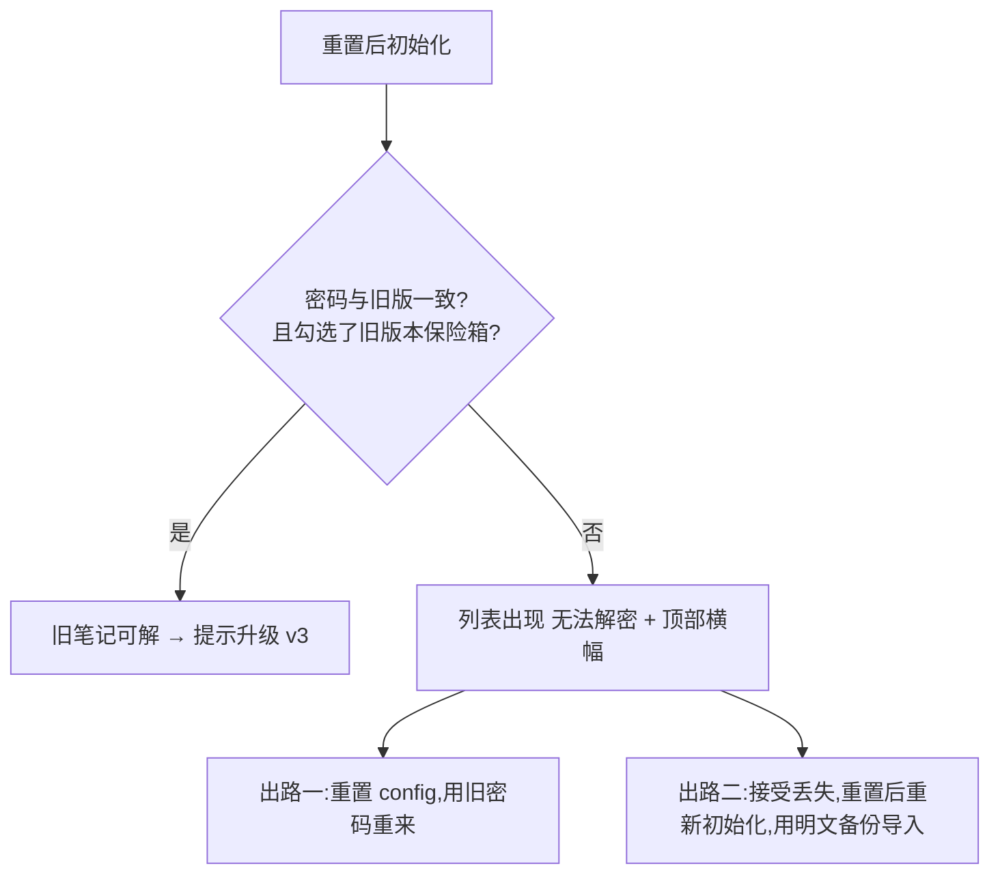

# 从旧版迁移到当前版本

本文覆盖三条迁移路径：**原地升级**（同密码、不丢数据）、**重置保险箱**（换密码 / 换了数据库 / 忘了初始化密钥）、以及**换设备**（旧库在主密钥派生参数上依赖过设备特征）。最后附故障对照表与检查清单。

> 一句话：**迁移前必须先拿到一份旧版能读的明文备份。** v3 升级后旧客户端再也解不开，回滚代码也救不回数据。

## 1. 先判断你在哪一版

```bash
curl -s https://<你的域名>/api/init-check   # {"initialized":true,"kdf_version":3,...}
curl -s https://<你的域名>/api/token        # {"salt":"…","kdf_mb":32,"kdf_ro":128,…}
```

| 现象 | 版本 | 说明 |
|---|---|---|
| `kdf_version: 1` | v1 | 无盐、无 Argon2 |
| `kdf_version: 2` | v2 | 有 Argon2，但仍无盐 |
| `kdf_version: 3` 且 `kdf_mb/kdf_ro` 存在 | 当前版 | 每库随机盐 + 成本参数绑定在保险箱上 |
| `kdf_version: 3` 但无 `kdf_mb/kdf_ro` | 早期 v3 | 成本参数没有绑定，见 §5 换设备问题 |

## 2. 迁移前：两份备份，至少一份是明文

1. **明文备份（必须）**：用**旧客户端**打开 → 导出备份。旧客户端能解开旧密文,导出的 JSON 是明文,这是唯一不依赖 KDF 版本、不依赖设备的救命备份。存到离线介质,并校验条目数。
2. **密文备份（可选，用于整库回滚）**：

```bash
npx wrangler d1 export s-qrypt-db --remote --output d1-backup-$(date +%Y%m%d).sql
```

## 3. 路径 A：原地升级（推荐，不丢数据）

适用于：仍能正常解锁，只是想换到当前版。

1. 部署当前版（见 §6 部署清单）。
2. 打开页面，用**原来的密码**解锁。
3. 若版本是 v1/v2，解锁后会提示升级到 v3 → 点升级。客户端会：生成新盐 → 用新配方派生新主密钥 → **把每篇笔记重新加密**（逐篇上传）→ 服务端写入 `salt` 与 `kdf_mb/kdf_ro`。
4. 校验：
   - 列表逐条能打开、标题正文正确；
   - 再导出一次备份，与 §2 的明文备份**逐条比对**（条数、标题、正文、时间戳）；
   - `curl /api/token` 能看到 `kdf_mb/kdf_ro`。

中途失败（网络断、某篇 409）时客户端会提示"N 篇失败、M 篇已完成"，**重新登录后可续做**：已完成的是 v3，未完成的仍是旧配方，不会重复加密。

> 这条「中断可续做」路径已在真实 Chromium + 真实 D1 上端到端验证：真 v2 库 → 落盐 → 只升级 1/3 → 重登录（新旧两把 MK 同时可读）→ 续做只补剩余 2 篇 → 再次登录稳定。证据见 `docs/review/2026-11-21-full-review.md` 附录 H。


## 4. 路径 B：重置保险箱（换密码 / 换库 / 忘了 SETUP_TOKEN）

适用于：`SETUP_TOKEN` 丢了导致初始化被拒、库被重建、或你明确要换密码。

1. 完成 §2 的**明文备份**（旧客户端）。
2. 清空配置（这会丢掉旧主密钥的校验值，密文还在，但只有旧密码能解）：

```bash
npx wrangler d1 execute s-qrypt-db --remote --command "DELETE FROM config WHERE id = 'app_config'"
```

3. 打开页面 → 初始化：
   - **要继续读旧密文**：密码必须填**旧程序的密码**，并勾选「旧版本保险箱（v1/v2）」。
   - **只需要干净重来**：用任意新密码初始化，旧密文不再需要（靠 §2 的明文备份恢复内容）。
4. 登录 → 若提示升级 v3 → 升级（把旧密文变成 v3）。
5. 若走的是"干净重来"，用「导入备份」把明文备份灌回去（追加合并、保留原时间戳）。
6. 校验同 §3 第 4 步。

> 初始化必须带 `SETUP_TOKEN`。线上用 `npx wrangler secret put SETUP_TOKEN`，本地用 `.dev.vars`（见 `.dev.vars.example`）。没配置时 `/api/init` 返回 503 `setup_token_not_configured`；输错返回 403 `invalid_setup_token`。

## 5. 密码不一致会怎样（会显式报错）

重置后如果**用了一个和旧笔记不同的密码**（或者忘了勾「旧版本保险箱」），会出现：

- **登录是成功的** —— 因为新初始化建的是新保险箱，令牌只校验新密码；
- 但旧笔记用新主密钥解不开，于是：
  - 列表里这些条目显示 **`[无法解密]`**（旧版显示为「数据损坏」，措辞已修正）；
  - 顶部出现常驻横幅：**「有 N 条笔记用当前密码解不开」**，正文明确写出两条出路，并给出可直接复制的重置命令；
  - 全部解密成功后横幅自动消失。



为什么不直接在登录时报"密码错误"：登录只能验证"你能否打开**当前**这个保险箱"，无法判断它和**历史密文**是不是同一把钥匙；密钥不匹配只会在解密旧数据时暴露。所以报错点放在解密失败处，并且给出可执行的修复路径，而不是一个空的"错误"。

### 换设备解锁报「密码错误」

早期版本的主密钥派生把 **Argon2/内存硬参数按设备估算**（`navigator.hardwareConcurrency`、`deviceMemory`，以及连续失败后的"加强"模式）。参数进了密钥，换设备就等于换钥匙。当前版已修正：

- 新建/升级的保险箱把 `kdf_mb/kdf_ro` **绑定在服务端**，任何设备都用同一组参数派生；
- 早期没有绑定参数的保险箱，登录会自动依次尝试 `硬件估算值 → 32/128 → 24/80 → 16/60`，命中后按该组参数继续并在审计日志写 `kdf_params_recovered`；
- 连续失败不再更换参数（那会让正确密码永远失败），改为增加固定延迟。

## 6. 部署侧迁移清单

| 项 | 动作 |
|---|---|
| 依赖 | `package.json` 与 `package-lock.json` 必须同步，否则 `npm ci` 直接 `EUSAGE` |
| 数据库列 | `config` 新增 `kdf_mb`、`kdf_ro`。Worker 启动时自动补列（`ensureColumn`）；也可手动执行 `ALTER TABLE config ADD COLUMN kdf_mb INTEGER NOT NULL DEFAULT 0` / `... kdf_ro ...` |
| 混淆产物 | 前端脚本在 `src/app.client.txt`（构建时注入模板），不再内联在 `index.ts` 里 |
| 初始化密钥 | 线上 `wrangler secret put SETUP_TOKEN`；本地 `.dev.vars`（模板见 `.dev.vars.example`，不要写真实口令） |
| CI | 类型检查 → 单测（含 KDF 参数绑定用例）→ 页面构建 → 混淆门禁 → 部署 |
| D1 一致性 | 读路径强制主库（避免副本滞后把"有内容"读成"空"） |

## 7. 回滚策略

- **数据回滚**：只能靠 §2 的备份。`d1-backup.sql` 是密文快照，需要**当时那套配方（盐 + 参数 + 密码）**才能读；跨版本回滚代码后，配方通常对不上。
- **代码回滚**：`git revert` 到上一个 tag 即可，但 v3 已重加密的笔记在旧客户端里会显示「无法解密」。
- 所以：**升级前的明文备份是唯一回滚保障**，不是"可选优化"。

## 8. 故障对照表

| 现象 | 含义 | 处理 |
|---|---|---|
| 503 `setup_token_not_configured` | 服务端没有 `SETUP_TOKEN` | 配置 secret 后重试 |
| 403 `invalid_setup_token` | 初始化密钥不对 | 用正确的 `SETUP_TOKEN` |
| 409 `already_initialized` | 已初始化 | 要重来走 §4 |
| 409 `orphan_notes` | 有笔记但没有配置，疑似误判空库 | 确认库没读错；确需覆盖时带 `force` |
| 503 `db_unavailable` | D1 读失败 | 检查 D1 绑定；客户端会阻止把"读不到"当"空库" |
| 服务端返回 0 条但本地有内容 | 副本滞后/抖动 | 客户端保留原视图 + 提示，不显示"保险箱是空的" |
| 列表出现 `[无法解密]` | 密钥不匹配 | 见 §5 |
| 解锁 12 秒后报 `timeout` | 网络挂起 | 读请求自动重试一次；写请求请重试保存 |

## 9. 迁移检查清单

- [ ] 旧客户端导出明文备份，条目数已核对
- [ ] （可选）`wrangler d1 export` 密文快照
- [ ] 判断当前 `kdf_version`
- [ ] 选择路径 A（原地升级）或 B（重置）
- [ ] 路径 B：`DELETE FROM config` 后初始化，密码与勾选项符合预期
- [ ] 登录后完成 v3 升级（如提示）
- [ ] 列表逐条可读，无 `[无法解密]`，无顶部横幅
- [ ] 再导出一次备份，与迁移前逐条比对
- [ ] `/api/token` 返回 `kdf_mb/kdf_ro`
- [ ] 在**另一台设备**用同一密码解锁成功（验证参数绑定生效）
